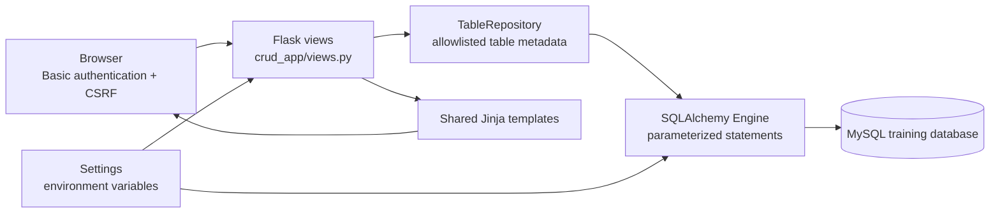
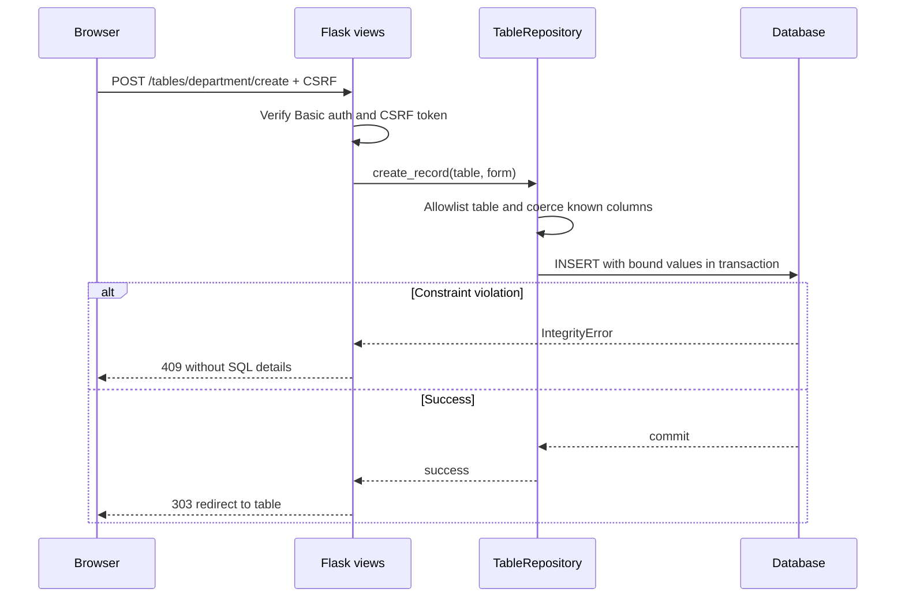

# Architecture and data flow

The architecture reflects the current implementation and intentionally remains a single Flask service rather than a distributed system.

## A CRUD request

The schema is reflected once on application startup. Only tables listed in `SUPPORTED_TABLES` and present in the database become browsable. Primary-key identities are encoded as URL-safe JSON tuples and decoded against the reflected key columns. They are **identifiers, not authorization tokens**, and every request is authenticated.

The `create_app` composition root validates configuration and constructs a database engine if one was not injected. `TableRepository` accepts that engine. Route handlers depend on the repository, not a global MySQL client. Database writes use `engine.begin()`, so failed operations roll back. Each HTML form is driven by column metadata, while the database remains authoritative for foreign keys and uniqueness.

## Deployment

Docker Compose optionally runs exactly two services: `web` (Gunicorn serving Flask) and `db` (MySQL). A named volume persists the database. There is no production deployment target or CDN configured. Outside local use, a separate TLS proxy and operational controls are needed.

These diagrams are maintained as editable Mermaid source and describe the current code, not a proposed infrastructure.
